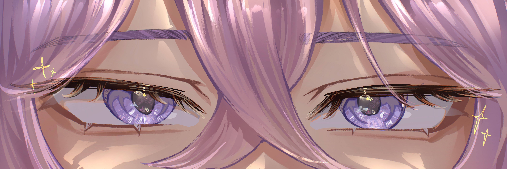

  
   
  <i>Banner commissioned by <a href="https://vgen.co/str4wberria">str4wberria </a></i>
   
  
  

 

---

### 

<table>
<tr>

<td valign="top" width="23%">

### 💻 Languages

</td>

<td valign="top" width="29%">

### ⚙️ Frameworks & Runtimes

</td>

<td valign="top" width="22%">

### 🐳 DevOps & OS

</td>

<td valign="top" width="26%">

### 🔧 Tools & Ecosystem

</td>

</tr>
</table>

### 

↳ AI — using it, building with it, letting it write my code 
↳ automation & DevOps — if I do it twice, I automate it 
↳ solving problems that make people's lives easier 

### 

↳ Kuusou 空想 — my little tinkering corner. Maintaining crates for [Cratebug](https://github.com/Kuusouu/Cratebug) 
↳ [Dots](https://github.com/mewclouds/dotfiles) — my Ruby-powered dotfiles ❤️ 
↳ [Rippie](https://github.com/rippieapp/rippie-core) — a music-link resolution npm package, aiming to connect music lovers 
↳ [Winutil](https://github.com/ChrisTitusTech/winutil) — giving back after years of lessons learned from CTT 
↳ [Drvctl](https://github.com/mewclouds/drvctl) — a driver control library meant to challenge old/legacy DISM 

### 

↳ Nyx — my homelab, focused on other projects and will resume later this year 

---

✨ <i><b>goal for 2026:</b> write fewer lines of code than last year directing AI (and somehow ship more)</i>
